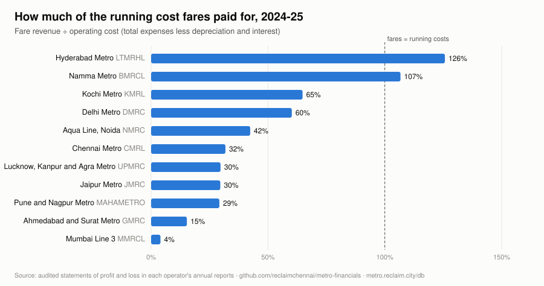
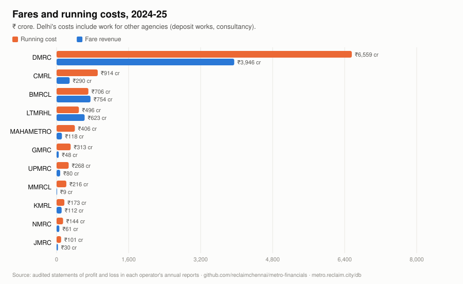
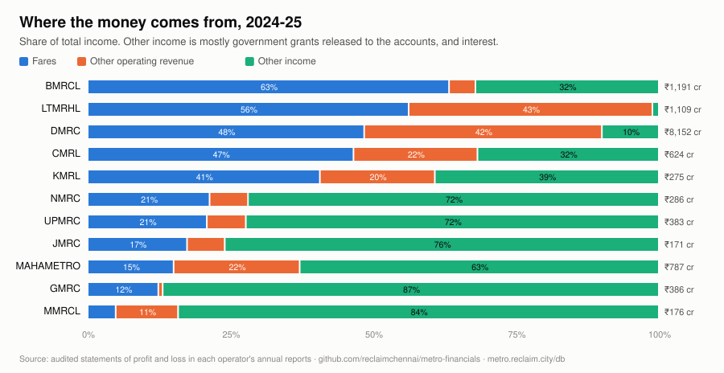
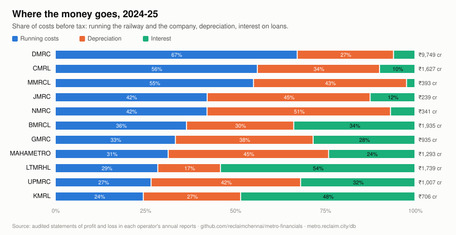
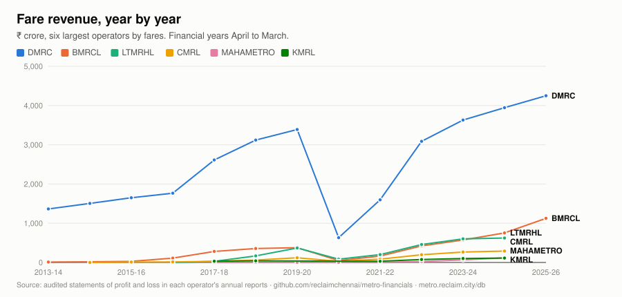
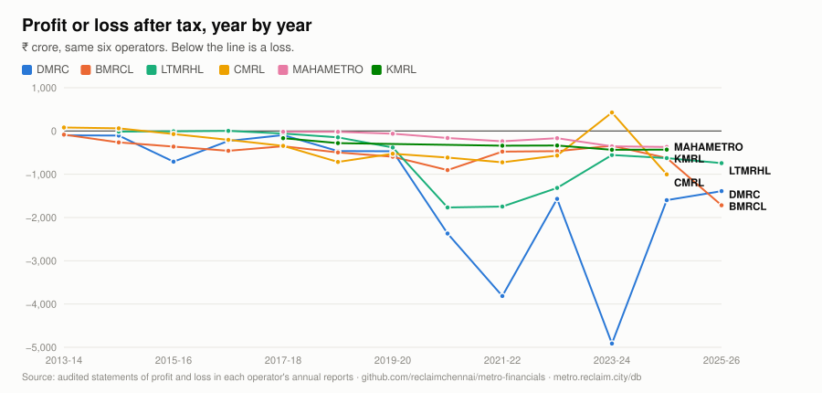

# Indian metro finances

The audited accounts of India's metro rail operators, year by year, read from their annual
reports: fare and other revenue, running costs, depreciation, interest and profit or loss, with
ridership and route length where the reports state them. Every figure carries the report, page
and line it comes from.

**Interactive charts and comparison tools: [metro.reclaim.city/db](https://metro.reclaim.city/db/)**
(also at [metro.reclaimchennai.city/db](https://metro.reclaimchennai.city/db/)): fares against
running costs for any year, where the money comes from and goes, any measure year by year, per
passenger trip, two operators side by side, and every figure linked to its report page.

## 2024-25 in brief

Fourteen operators published accounts for 2024-25 (all money in ₹ crore):

| | |
|---|---:|
| Fares collected | 6,070 |
| Revenue from operations | 10,434 |
| Running costs (before depreciation and interest) | 10,394 |
| Depreciation | 6,048 |
| Interest on loans | 3,634 |
| Profit or loss after tax, all together | −6,228 |

Fares covered running costs at two of the eleven operators with a fare split: Hyderabad (126%)
and Bengaluru (107%). One operator made a profit after tax: NCRTC, which booked no revenue from
operations that year; its income was other income.













Delhi's revenue and costs include work it does for other agencies (deposit works, consultancy);
Hyderabad's revenue from operations includes real-estate income. Other caveats, all the tables
behind these charts and the restatements are in [ANALYSIS.md](ANALYSIS.md).

## Files

| File | What |
|---|---|
| `data/verified/<OP>.json` | Every figure read from each report: value, page, the line as printed, unit, checks, restatements |
| `data/finance.json` | One entry per operator and year, ₹ crore, with sources and later restatements |
| `data/finance.csv` | The same, flat |
| `data/sources.json` | Every report used: operator, year, original URL, file name |
| `ANALYSIS.md` | Tables computed from the data: each year by operator, trends, per trip, restatements |
| `METHOD.md` | How the figures were read and checked, and the definitions used |
| `docs/charts/` | The charts above (SVG) |
| `scripts/build.py` | Builds `finance.json`, `finance.csv` and `ANALYSIS.md` from the verified files |
| `scripts/charts.py` | Draws the charts from `finance.json` |
| `scripts/download.py` | Downloads the reports listed in `sources.json` into `reports/` (not in git) |

## Operators

Delhi (DMRC), Noida (NMRC), Rapid Metro Gurugram (RMGL, RMGSL), Namo Bharat (NCRTC), Bengaluru
(BMRCL), Chennai (CMRL), Hyderabad (LTMRHL), Mumbai Line 1 (MMOPL), Mumbai Line 3 (MMRCL),
Mumbai Lines 2A and 7 (MMMOCL, turnover only), Pune and Nagpur (Maha Metro), Ahmedabad and Surat
(GMRC), Kochi (KMRL), Jaipur (JMRC), Kolkata East-West (KMRCL), Lucknow, Kanpur and Agra (UPMRC),
Bhopal and Indore (MPMRCL): 18 operators, 181 operator-years. Years covered and gaps per operator
are in `ANALYSIS.md`.

Not covered: Metro Railway Kolkata (part of Indian Railways, no separate published accounts),
Patna (no published accounts yet) and Navi Mumbai (inside CIDCO's accounts).

## Rebuild

```
python3 scripts/download.py        # optional: the source PDFs
python3 scripts/build.py
python3 scripts/charts.py
```

## Licence

Data: the operators' published annual reports. Compilation and code by
[@reclaimchennai](https://x.com/reclaimchennai), CC BY 4.0.
